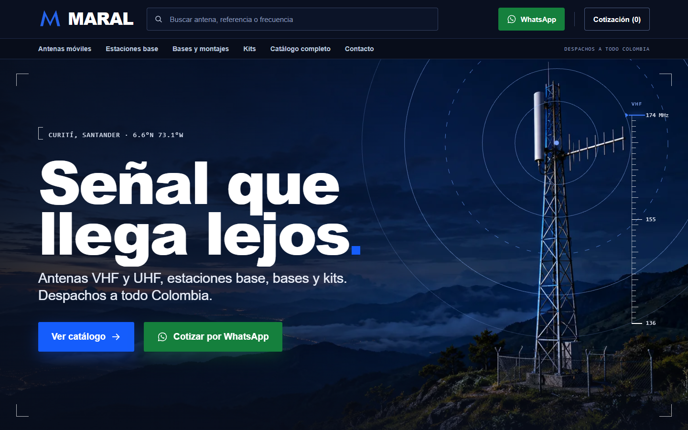
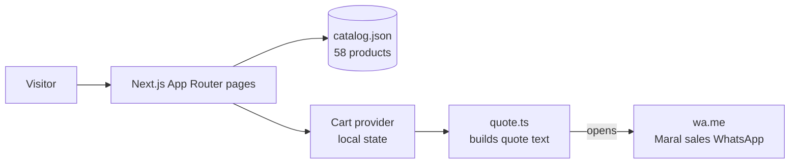

# MARAL Website

**Product catalog and quote site for Maral Tecnología y Comunicaciones: 58 radio-communication antennas and bases, browsable by category and brand, quoted through WhatsApp.**

The site is a Next.js 16 App Router front end with no backend. Visitors browse the catalog, add products to a cart and send a prefilled quote request to Maral's sales WhatsApp. Catalog data is read from a local JSON file, so the site builds and runs without any API.

> Company contact details in this copy are placeholders. See [Status](#status).

---

## Screenshots



*Home page of the Maral storefront for VHF/UHF antennas, base stations and kits.*

## Features

- **Catalog:** 58 products from the published catalog, 31 with a published price. Category pages (`/categoria/[slug]`), product pages (`/producto/[slug]`) and a shop with search and filters (`/tienda`).
- **Cart and quote request:** cart (`/carrito`), then a checkout form that builds a quote message with the selected products, subtotal and contact data, and opens WhatsApp with it. Items without a published price are counted as "to be quoted".
- **Home page:** hero, band finder, product rails, bento sections and an assets-backed "made in" block.
- **Legacy redirects:** old paths from the earlier layout redirect to the matching section (for example `/principal/shopping_cart` to `/carrito`).
- **Account screens:** login and registration are demo forms. They do not store anything and redirect to contact, because Maral quotes without client accounts.

## Stack

- Next.js 16.3.5 (App Router), React 19, TypeScript (strict).
- Tailwind CSS 4 with layered CSS (`globals.css` → `maral-tokens.css` → `maral-home.css` / `maral-shop.css`).
- shadcn/ui and Base UI primitives, `class-variance-authority`, `lucide-react`.
- Docker image on Node with `output: standalone` (`node server.js`, port 3000).

## Architecture



No server-side API. The only outbound link is the WhatsApp hand-off.

## Structure

```
.
├── src/                 App Router pages, components, styles and data helpers (see src/README.md)
├── public/              Static images and product assets (see public/README.md)
├── docs/                Design comps, source research and the handoff note (see docs/README.md)
├── odd/                 Feature task specs (see odd/README.md)
├── tests/               Node test files for the catalog and quote logic
├── .github/workflows/   CI: lint, typecheck, build
└── Dockerfile           Production image (port 3000)
```

## Run it

```bash
npm ci
npm run dev        # http://localhost:3000
npm run check      # lint + typecheck + build
node --test tests/industrias-maral/   # currently fails, see Status
```

CI (`.github/workflows/ci.yml`) runs `npm run lint`, `npm run typecheck` and `npm run build` on pushes and pull requests to `master`, using Node 24.

## Status

- The handoff note (`docs/HANDOFF_2026-10-09.md`) records that the site compiles and passes typecheck, lint and build, but had not been reviewed visually at that date.
- The tests in `tests/industrias-maral/` import `src/lib/industrias-maral/catalog.mjs`, which is not in the repository, so `node --test` fails until that module is added or the tests are updated.
- Catalog facts come from a static read of the public catalog on 2026-10-09. Prices are published values that the company must confirm before quoting, as stated in the catalog file.
- Contact details (phone, WhatsApp, email) in `src/lib/site.ts` are placeholders in this copy.
- The `public/sites/syscom-colombia/` folder keeps only the Satoshi font that the stylesheet loads. Layout code still has SYSCOM-era class names and comments. See `src/app/globals.css`.

## License

The `LICENSE` file is the MIT license inherited from the upstream template this project started from. Confirm the license for Maral's own code before publishing.
